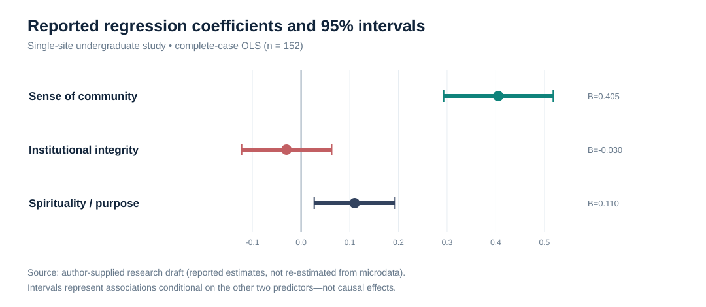
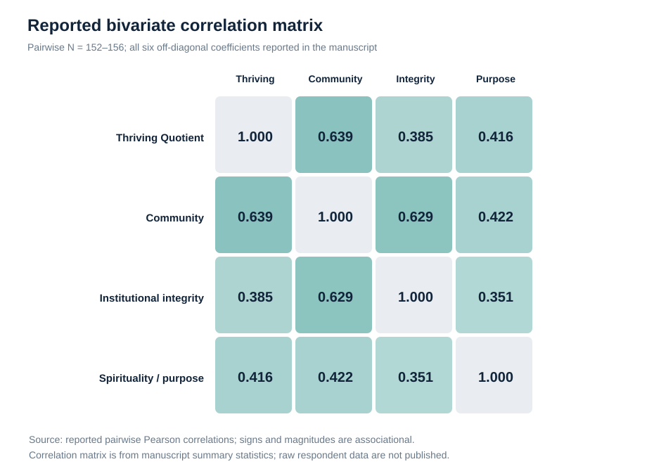
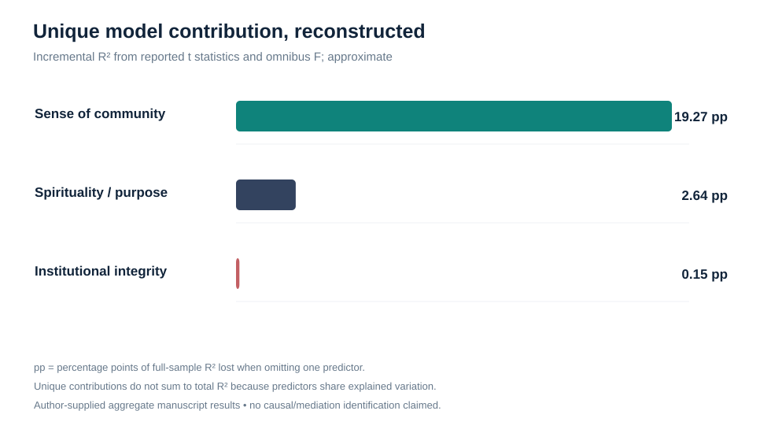
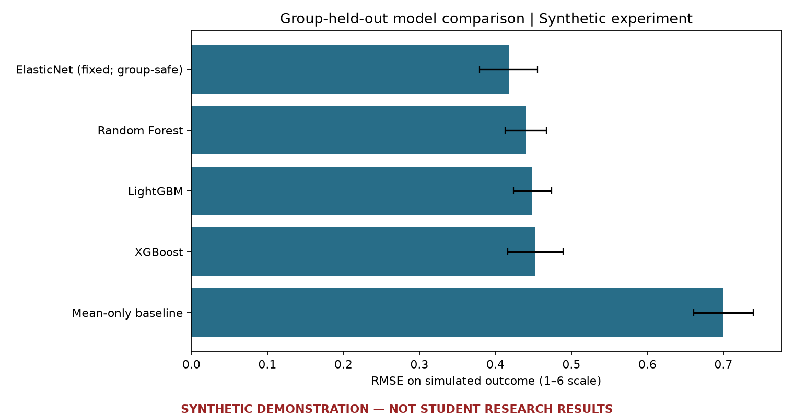
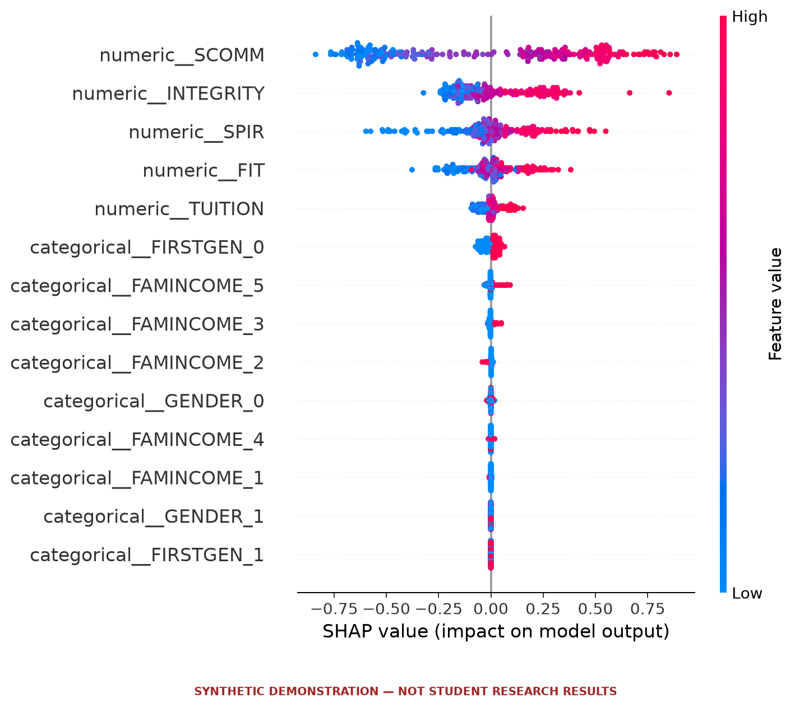
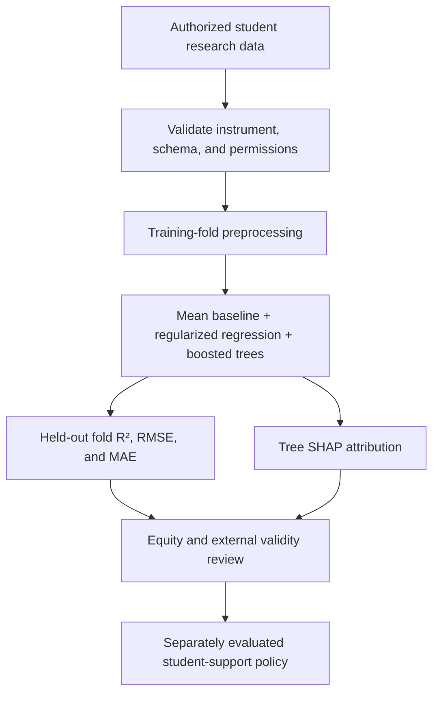

# Student Flourishing in Higher Education
### Explainable Machine Learning · Educational Research · Responsible Policy

[](https://github.com/muhammad-siddique-research/higher-ed-flourishing-prediction-ml-xai/actions/workflows/synthetic-demo.yml)
[](https://github.com/muhammad-siddique-research/higher-ed-flourishing-prediction-ml-xai/actions/workflows/ci.yml)
[](LICENSE)


**Predicting and explaining undergraduate flourishing (Thriving Quotient) using regularized regression, gradient-boosted decision trees (XGBoost/LightGBM), and Tree SHAP interpretability—with transparent validation and responsible educational policy translation.**

This repository connects an **actual reported undergraduate survey study** with reproducible aggregate-level econometric audits, an authorized-data robustness implementation, and an exploratory scikit-learn/XAI research pipeline. Its computational demonstrations remain distinct from original student-data validation and causal identification.

> **Research integrity statement:** The source student-level data, model output files, and independent econometric replication materials are **not available in this public repository**. Historical performance and causal claims in a prior README have been preserved in [an explicitly unverified archive](docs/LEGACY_RESULTS_UNVERIFIED.md). The Streamlit application is a **construct-exploration and policy-governance lab**, not a fitted prediction service.

## Real-world undergraduate study | Reported empirical evidence

**Source:** Author-supplied 30-page research draft describing a
**single-site undergraduate survey (N = 156; complete-case OLS n = 152)**.
The underlying participant-level dataset and original model-output files
have **not** been supplied. The real-study visualizations below display
manuscript-reported statistics, *not* re-estimated microdata or validated
out-of-sample machine-learning predictions.

<details>
<summary><b>Evidence status: reported results, reproducibly audited from aggregates</b></summary>

- Manuscript: *Predicting Undergraduate Students' Thriving: An Empirical
  Econometric and Psychosocial Investigation in Higher Education*
  (Siddique & Briggs, research draft).
- Original respondent records are not publicly released and have not been
  independently audited.
- Regression-model consistency and additional partial R² and VIF
  calculations can be reproduced from the reported tables.
- Previously claimed XGBoost/LightGBM accuracy statistics remain
  **unverified** on the original student data.

</details>

| Study evidence | Reported or calculated result |
|---|---|
| Participants | 156 surveyed; 152 complete-case OLS observations |
| Model | Thriving Quotient ~ community + integrity + spirituality |
| In-sample fit | **R² = .436**, adjusted **R² = .424** |
| Omnibus test | **F(3, 148) = 38.11, p < .001** |
| Community association | **B = .405, 95% CI [.293, .518]** |
| Integrity association | B = −.030, 95% CI [−.122, .063] |
| Spirituality/purpose association | B = .110, 95% CI [.027, .193] |

### Real-study regression coefficients and confidence intervals



*Source: reported multivariable OLS table from the author's research draft.
Confidence intervals are descriptive of estimated conditional associations,
not effects of interventions.*

### Empirical correlations among flourishing constructs



*Source: reported pairwise correlation matrix (N varying from 152–156).*

### Advanced econometric insight: uniquely explained variation



*Derived aggregate-data audit—not an original-data re-estimation. Community
has the largest drop-one-predictor incremental R² (approximately .193),
followed by spirituality (.026) and institutional integrity (.002).
These quantities are not causal contributions.*

**Reproduce the audit, no private dataset required:**

```bash
python -m src.reported_evidence_audit
```

**Advance to new econometric inference after authorized data access:**

```bash
python -m src.real_data_econometrics --data /secure/path/real_study.csv \
  --output-dir results/real_study --bootstrap 1000
```

The new runner implements **HC3-robust OLS**, the **Breusch–Pagan test**,
**Ramsey RESET**, **VIF**, **Cook's distance**, **nested model ΔR²**, and
**case-resampling confidence intervals**. These methods are *implemented*,
but their new empirical results are **not yet available**. The missing
participant data cannot be reconstructed reliably from a 30-page summary.

**Explore:** [Full reported-study analysis](docs/EMPIRICAL_EVIDENCE.md) ·
[Advanced econometric protocol](docs/ADVANCED_ECONOMETRICS.md) ·
[Research-to-policy recommendations](docs/EDUCATION_POLICY_BRIEF.md) ·
[Restricted data and codebook crosswalk](data/README.md)

---

## Research at a glance

| Dimension | Research approach |
|---|---|
| **Problem** | Understand how psychosocial and institutional experiences relate to undergraduate thriving |
| **Outcome** | `TQ_MEAN`: project-described 24-item thriving composite (1–6; scoring not independently audited) |
| **Predictors** | Sense of community, institutional integrity, spirituality/meaning, perceived fit, tuition value, first-generation status, gender code, family income tier |
| **Statistical learning** | Mean baseline, ElasticNetCV, Random Forest, XGBoost, LightGBM |
| **Validation** | Train-fold preprocessing, 10-fold R² / RMSE / MAE; optional group-disjoint CV |
| **Explainability** | Exploratory Tree SHAP; model attribution **does not imply causality** |
| **Policy focus** | Equitable student support, transparent evidence standards, privacy, and governance |
| **Current evidence** | Real-study **manuscript-reported** OLS aggregates and derived audit, plus synthetic-only ML/XAI demonstrations; original-data replication pending |

## Why this research matters

Student flourishing cannot be responsibly reduced to a ranking or algorithmic label. Institutions need reliable measures of students' experiences, defensible estimates of predictive uncertainty, and evidence that proposed supports are both useful and equitable. This repository separates:

1. **Educational theory:** hypotheses about belonging, institutional trust, autonomy, and meaning.
2. **Predictive evidence:** out-of-fold model accuracy and attribution, after ethical access to study data.
3. **Causal evidence:** the additional research designs required to estimate an intervention's effect.
4. **Policy translation:** governance, accessibility, meaningful stakeholder engagement, and monitored implementation.

The theoretical framing draws on [Tinto (1975)](https://doi.org/10.3102/00346543045001089), [Astin (1984)](docs/RESEARCH_DESIGN.md), and [Ryan and Deci (2000)](https://doi.org/10.1037/0003-066X.55.1.68). Feature-level explanation is informed by [Lundberg and Lee (2017)](https://arxiv.org/abs/1705.07874).

## Executable research demonstration | Explicitly synthetic data

The project now contains an executable demonstration of the full
**mean-only baseline → regularized ElasticNet → Random Forest → XGBoost →
LightGBM** model comparison. It generates 240 *hypothetical* student records
assigned to 12 *hypothetical* institutions and evaluates them with
**group-disjoint cross-validation**. An optional XGBoost Tree SHAP figure
shows how the fitted example model attributes its synthetic predictions.

```bash
python -m examples.synthetic_demo
python -m examples.synthetic_demo --shap
```

A separate [GitHub Actions demonstration workflow](.github/workflows/synthetic-demo.yml) executes the example with Tree SHAP and publishes a downloadable, explicitly synthetic research artifact for inspection.

**All generated results and figures are marked SYNTHETIC and are not
evidence about actual students or empirical model performance.**
The outputs are stored locally in the git-ignored `demo_outputs/` directory.

Read the [Model Card](docs/MODEL_CARD.md),
[education policy brief](docs/EDUCATION_POLICY_BRIEF.md),
[research-validation checklist](docs/VALIDATION_CHECKLIST.md) and
[privacy-conscious subgroup diagnostics](src/policy_diagnostics.py).

## Visual analytics: ElasticNet, XGBoost, LightGBM, and Tree SHAP

**Executed computational demonstration using simulated observations—not real
student outcomes or validated institutional performance.** The charts below
are generated by [the reproducible synthetic research workflow](.github/workflows/synthetic-demo.yml)
and stored in the repository (not just as ephemeral Actions downloads).

### A. Out-of-group prediction performance



*Figure 1. Synthetic 3-fold group-disjoint model comparison (240 fictitious
records, 12 simulated campuses). Lower RMSE is better; error bars show the
between-fold standard deviation. These results **do not** establish
effectiveness on actual students.*

| Model | R² | RMSE | MAE |
|---|---:|---:|---:|
| **ElasticNet (fixed penalty)** | **0.641** | **0.417** | **0.338** |
| Random Forest | 0.601 | 0.440 | 0.349 |
| LightGBM | 0.585 | 0.449 | 0.365 |
| XGBoost | 0.579 | 0.453 | 0.355 |
| Mean-only baseline | −0.009 | 0.700 | 0.571 |

**Takeaway:** The simpler regularized model performs best under the *specified
synthetic data-generating process*. That illustrates why credible ML research
benchmarks model complexity rather than assuming boosted trees must dominate.

### B. Tree SHAP: understanding predictions, not causes



*Figure 2. **Synthetic-only** full-sample Tree SHAP explanation of an
XGBoost model. Feature positions and colors illustrate model attributions.
This is not a cross-validated importance estimate, causal effect, or
psychological finding.*

In this artificial example, sense of community (`SCOMM`) has the widest SHAP
spread because the simulation explicitly encodes its relationship with the
constructed outcome. **Do not infer that changing `SCOMM` or any other
variable would improve a real student's flourishing.**

[Read the detailed, methods-aware interpretation](docs/VISUAL_ANALYSIS.md) ·
[Inspect synthetic model scores](docs/figures/SYNTHETIC_model_metrics.csv) ·
[Inspect fold-level validation](docs/figures/SYNTHETIC_fold_metrics.csv)

## Research-to-policy workflow



## Model architecture

```text
Authorized, institutionally governed study data
           |
           v
Schema + target validation (1–6 composite)
           |
           v
Outer CV: KFold or group-disjoint GroupKFold
           |
           +--> Fold-specific numeric imputation & standardization
           |    + categorical imputation & one-hot encoding
           |
           +--> Mean baseline | ElasticNetCV | RF | XGBoost | LightGBM
           |
           v
Held-out fold R², RMSE, MAE + variability
           |
           +--> Optional exploratory full-sample Tree SHAP
           |
           v
Interpretive review + transportability/fairness checks
           |
           v
Separately evaluated educational policy decisions
```

**Methodological boundary:** ElasticNetCV uses inner training-data cross-validation to select its penalty. Tree-based candidates have fixed documented settings; the code does not claim a fully nested search for all algorithms or independent test-set validation.

## Feature dictionary

| Field | Role | Interpretation |
|---|---|---|
| `TQ_MEAN` | Target | Thriving composite, project-described 1–6 scale |
| `SCOMM` | Numeric predictor | Sense of community / belonging |
| `INTEGRITY` | Numeric predictor | Institutional integrity or trust |
| `SPIR` | Numeric predictor | Spirituality, purpose, or meaning measure |
| `TUITION` | Numeric predictor | Perceived tuition value, **not** a validated instrument |
| `FIT` | Numeric predictor | Perceived institutional fit |
| `FIRSTGEN` | Categorical predictor | First-generation status as coded in source |
| `GENDER` | Categorical predictor | Gender coding as provided; inclusivity must be audited |
| `FAMINCOME` | Categorical predictor | Reported family-income tier |

> **No student-level dataset is included.** Scale validity, coding, sample design, permissions, and fairness implications must be reviewed with the original data owner before a new research claim or application.

## Run the reproducible pipeline

```bash
git clone https://github.com/muhammad-siddique-research/higher-ed-flourishing-prediction-ml-xai.git
cd higher-ed-flourishing-prediction-ml-xai
python -m pip install -r requirements.txt
python -m pip install pytest
python -m pytest -q
# Study-authorized data only:
python -m src.train_and_evaluate --data /secure/path/student_thriving.csv
# If people or institutions recur:
python -m src.train_and_evaluate --data /secure/path/student_thriving.csv --group-column STUDENT_ID --folds 5
# Add exploratory SHAP output if permitted:
python -m src.train_and_evaluate --data /secure/path/student_thriving.csv --shap
```

The script generates aggregate results under `results/`, which is ignored by Git. It deliberately fails when study data are unavailable; it **never creates fabricated real-data metrics**. Authorized-data experiments now include **fold-level** scores, and grouped analysis avoids ungrouped inner penalty tuning. Automated CI tests use synthetically generated records only, and must not be cited as empirical model validation.

For instructions and research standards, see [Reproducibility](docs/REPRODUCIBILITY.md) and [Data Access](data/README.md).

## Interactive research and policy lab

**[Open the Streamlit app](https://higher-ed-flourishing-prediction-ml-xai-cj3qpcffjve46ochqrdtn9.streamlit.app/)**

The dashboard explains the available evidence and allows users to visualize **hypothetical perception profiles** for five constructs. The bar chart shows the input values, **not** a predicted score, effect estimate, validated risk category, or automated student assessment. A governance checklist highlights what must be established before considering institutional adoption.

## Responsible research and policy translation

- **Privacy:** educational records require institutionally approved data access; no raw student data or identifiers should be committed.
- **Fairness:** check errors and measurement validity across relevant student groups, with adequate data and appropriate ethical safeguards.
- **Interpretability:** SHAP identifies associations within fitted predictions, not mechanisms or interventions.
- **Generalizability:** institution/cohort and time-shift validation are necessary before applying models beyond the original sample.
- **Decision integrity:** no admissions, financial-aid, counseling, academic-probation, or support eligibility decisions from this prototype.

Read [Research Design](docs/RESEARCH_DESIGN.md), [Data Governance](docs/DATA_GOVERNANCE.md), [Model Card](docs/MODEL_CARD.md), and [Education Policy Brief](docs/EDUCATION_POLICY_BRIEF.md).

## Repository navigation

```text
.
├── README.md                        Flagship evidence and ML/XAI overview
├── evidence/manuscript_summary.json Real-study aggregates (not raw data)
├── src/reported_evidence_audit.py   Reconstructed inferential diagnostics
├── src/real_data_econometrics.py    HC3, bootstrap, BP, RESET, nested models
├── docs/EMPIRICAL_EVIDENCE.md       Reported real-study results and charts
├── docs/ADVANCED_ECONOMETRICS.md    Econometric methodology and caveats
├── app/streamlit_app.py             Research and policy exploration UI
├── src/train_and_evaluate.py        Validated benchmark + optional SHAP
├── data/README.md                   Restricted data contract
├── docs/                            Design, ethics, replication, legacy archive
├── tests/test_workflow.py           Synthetic-only integrity tests
├── .github/workflows/ci.yml         Automated CI
├── requirements.txt                 Environment dependencies
├── examples/synthetic_demo.py         Explicitly simulated full ML/XAI demonstration
├── src/policy_diagnostics.py         OOF aggregated errors with suppression
├── docs/MODEL_CARD.md                Validity and intended-use boundaries
├── docs/EDUCATION_POLICY_BRIEF.md    Educational policy translation
├── docs/VALIDATION_CHECKLIST.md     Publication-readiness rubric
├── CITATION.cff                      Software citation metadata
└── LICENSE                           MIT license for repository code
```

## Research team and attribution

- **Muhammad Siddique** — PhD candidate; research, econometrics, machine learning, educational technology, and reproducibility.
- **Chad Briggs** — listed as a collaborator in the original repository; institutional research and effectiveness, Judson University.

Institutional affiliations and substantive authorship roles should be confirmed with project contributors before formal academic publication. Code licensing does not confer rights to distribute student records.

## How to cite

Use [CITATION.cff](CITATION.cff) for this software repository. Cite individual empirical studies and datasets separately, using their authorized bibliographic records. **A GitHub repository is not, by itself, evidence of peer-reviewed validation.**

## Roadmap toward a publication-grade study

- [x] Implement baseline + four model families, train-fold transformations, optional SHAP
- [x] Add schema checks, group-aware CV option, ethical policy interface, and synthetic-only CI
- [x] Attribute and audit reported real-study aggregates, including model consistency and unique contributions
- [x] Implement an authorized-data econometric robustness runner (HC3, bootstrap, diagnostics)
- [ ] Secure and document the authorized source dataset and survey instrument
- [ ] Recompute benchmark tables with reproducible experiment manifests
- [ ] Validate psychometric scoring, measurement invariance, missingness, and possible leakage
- [ ] Evaluate across cohorts and institutions with credible uncertainty
- [ ] Review fairness, governance, stakeholder impact, and intervention evidence
- [ ] Publish a results paper only after verification and necessary research approvals
