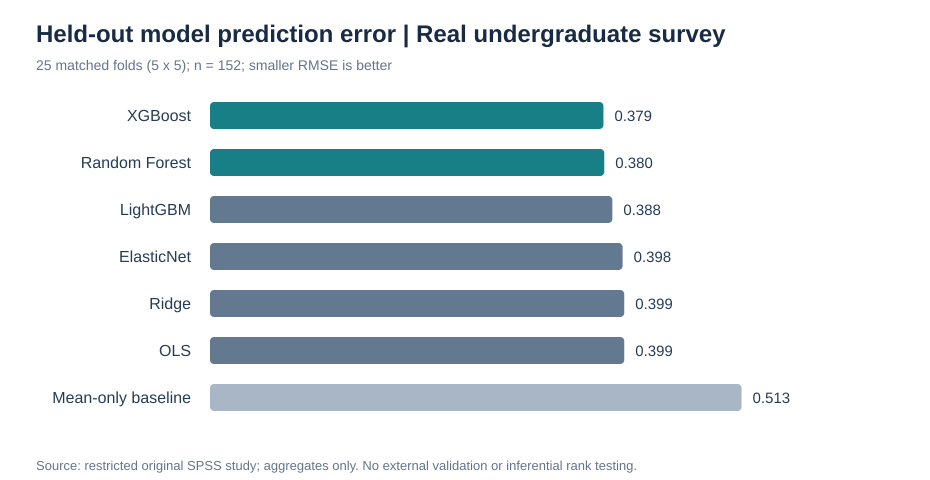
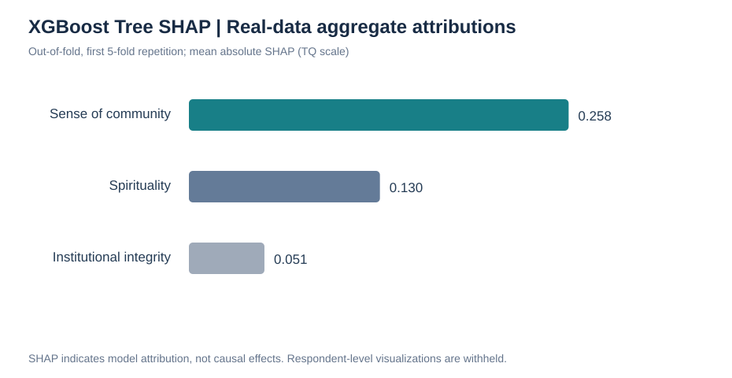
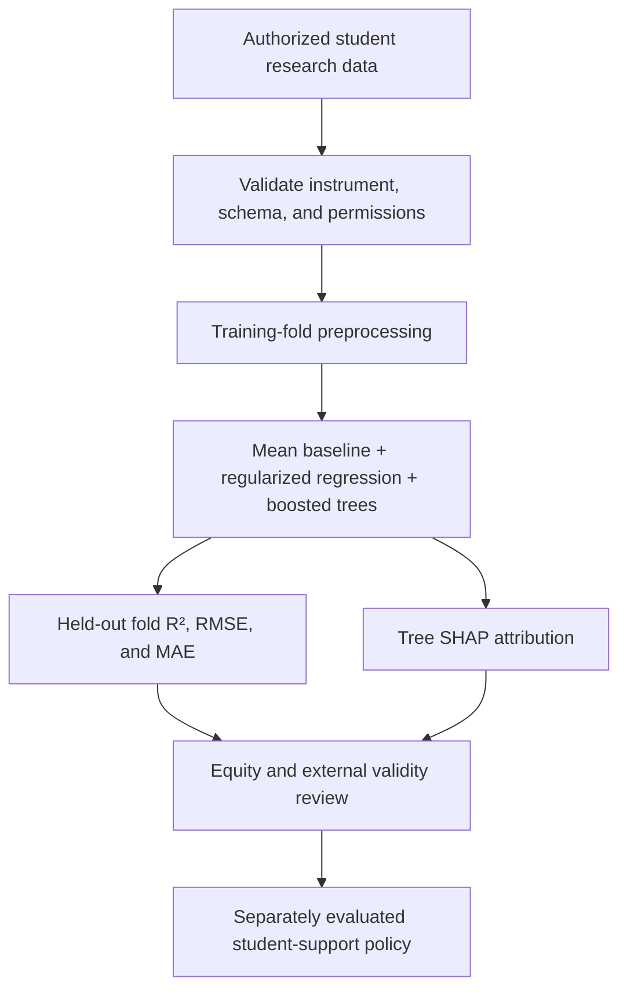

# The Science of Student Thriving: Econometrics and Explainable AI Analysis
### Real-data Econometric Evidence · Internal ML Validation · Transparent Educational Policy

[](https://github.com/muhammad-siddique-research/higher-ed-flourishing-prediction-ml-xai/actions/workflows/synthetic-demo.yml)
[](https://github.com/muhammad-siddique-research/higher-ed-flourishing-prediction-ml-xai/actions/workflows/ci.yml)
[](LICENSE)


**Reanalysis of a Real Undergraduate Survey (N = 156; Analytic n = 152)** integrating replicated OLS, HC3-robust inference, XGBoost, Random Forest, LightGBM, regularized regression, and held-out Tree SHAP. The research aims to clarify how community belonging, institutional integrity, and spirituality relate to thriving, without mistaking predictive attribution for causal mechanisms.

**Evidence Provenance:** Original SPSS participant-level data have been analyzed **privately**, and the revised author manuscript reports the corresponding econometric and internal ML/XAI findings. The dataset itself is **not public**, and the manuscript is a **working scholarly draft—not represented as peer-reviewed or published**. Public materials in this repository include aggregate results and privacy-conscious visualizations, together with a **separate, clearly synthetic software demonstration**.

**[Explore original-data empirical results and publication-safe figures →](docs/REAL_DATA_VALIDATION.md)**


## Real Undergraduate Study | Econometrics, Predictive Modeling, and XAI

The **original restricted SPSS survey** includes **156 undergraduate respondents** at one private Midwestern U.S. institution, with **152 complete cases** for the primary three-predictor study. Results below derive from private analysis of these **real observations**, not simulation.

### Primary Regression and HC3-Robust Uncertainty

| Econometric finding | Original-data result |
|---|---|
| Model | TQ_MEAN ~ SCOMM + INTEGRITY + SPIR |
| Overall OLS fit | **R² = .436**, adjusted R² = .424; **F(3, 148) = 38.11** |
| Sense of community | **B = .405**, HC3 95% CI **[.267, .543]** |
| Institutional integrity | B = −.030, HC3 95% CI [−.125, .066] |
| Spirituality | B = .110, HC3 95% CI [.008, .212] |
| Specification diagnostics | Breusch–Pagan p = .0085; Ramsey RESET p = .0007 |

The diagnostics motivate **robust inference and careful model interpretation**, not conclusions about causal pathways or validated mediation. Spirituality's coefficient is less stable in an exploratory extended specification.

### Out-of-Sample Prediction within the Same Institution

Seven model configurations were compared across **5-fold cross-validation repeated five times (25 matched held-out folds)**, using the three theory-specified predictors. Differences between XGBoost and Random Forest are **negligible** relative to model variability.

| Algorithm | Mean RMSE ↓ | Mean MAE ↓ | Mean fold R² ↑ |
|---|---:|---:|---:|
| **XGBoost** | **.3794** | **.2906** | .3814 |
| Random Forest | .3802 | .2931 | **.3840** |
| LightGBM | .3880 | .3031 | .3537 |
| ElasticNet | .3979 | .2995 | .3315 |
| Ridge | .3994 | .3001 | .3251 |
| OLS | .3995 | .3006 | .3183 |
| Mean-only baseline | .5126 | .4052 | −.0466 |



*Mean of 25 overlapping held-out-fold RMSEs. These are internal validation results; no cross-institution test or statistical claim of winner superiority is made.*

### Explainable AI | Aggregate held-out SHAP

The **first five-fold repetition** yielded withheld-case XGBoost explanations for 152 participants. Public reporting includes only the **aggregate SHAP magnitudes**, not respondent-level plots.



Mean absolute SHAP: community **.2584**; spirituality **.1300**; integrity **.0514**. These values reflect model feature reliance and **do not imply causal or intervention effects**.

**Full documentation and public aggregates:** [Original-data results](docs/REAL_DATA_VALIDATION.md) · [CV metrics](evidence/REAL_STUDY_cv_summary.csv) · [SHAP summaries](evidence/REAL_STUDY_shap_summary.csv) · [Research-to-policy brief](docs/EDUCATION_POLICY_BRIEF.md)

**The historical manuscript-only aggregate audit is preserved for transparency** in [the former-study evidence document](docs/EMPIRICAL_EVIDENCE.md). Synthetic algorithm demonstration figures and scores remain separate below; they are **not** empirical results.

---

## Research at a Glance

| Dimension | Research approach |
|---|---|
| **Problem** | Understand how psychosocial and institutional experiences relate to undergraduate thriving |
| **Outcome** | `TQ_MEAN`: project-described 24-item thriving composite (1–6; scoring not independently audited) |
| **Predictors** | Sense of community, institutional integrity, spirituality/meaning, perceived fit, tuition value, first-generation status, gender code, family income tier |
| **Statistical learning** | Mean baseline, ElasticNetCV, Random Forest, XGBoost, LightGBM |
| **Validation** | Original-data study: repeated 5×5-fold internal CV; separate generic modeling pipeline offers other CV configurations |
| **Explainability** | Exploratory Tree SHAP; model attribution **does not imply causality** |
| **Policy focus** | Equitable student support, transparent evidence standards, privacy, and governance |
| **Current evidence** | Privately reanalyzed original SPSS data, original-data 25-fold ML benchmark and held-out aggregate SHAP; separate synthetic CI demonstrations. External validation pending. |

## Why this Research Matters?

Student flourishing cannot be responsibly reduced to a ranking or algorithmic label. Institutions need reliable measures of students' experiences, defensible estimates of predictive uncertainty, and evidence that proposed supports are both useful and equitable. This repository separates:

1. **Educational theory:** hypotheses about belonging, institutional trust, autonomy, and meaning.
2. **Predictive evidence:** out-of-fold model accuracy and attribution, after ethical access to study data.
3. **Causal evidence:** the additional research designs required to estimate an intervention's effect.
4. **Policy translation:** governance, accessibility, meaningful stakeholder engagement, and monitored implementation.

The theoretical framing draws on [Tinto (1975)](https://doi.org/10.3102/00346543045001089), [Astin (1984)](docs/RESEARCH_DESIGN.md), and [Ryan and Deci (2000)](https://doi.org/10.1037/0003-066X.55.1.68). Feature-level explanation is informed by [Lundberg and Lee (2017)](https://arxiv.org/abs/1705.07874).

## Separate Reproducible Demonstration | Explicitly Synthetic Data

The project now contains an executable demonstration of the full
**mean-only baseline → regularized ElasticNet → Random Forest → XGBoost →
LightGBM** model comparison. It generates 240 *hypothetical* student records
assigned to 12 *hypothetical* institutions and evaluates them with
**group-disjoint cross-validation**. An optional XGBoost Tree SHAP figure
shows how the fitted example model attributes its synthetic predictions.

```bash
python -m examples.synthetic_demo
python -m examples.synthetic_demo --shap
```

A separate [GitHub Actions demonstration workflow](.github/workflows/synthetic-demo.yml) executes the example with Tree SHAP and publishes a downloadable, explicitly synthetic research artifact for inspection.

**All results and figures are marked SYNTHETIC and are evidence about actual students dataset or empirical model performance.**
The outputs are stored locally in the git-ignored `demo_outputs/` directory.

Read the [Model Card](docs/MODEL_CARD.md),
[education policy brief](docs/EDUCATION_POLICY_BRIEF.md),
[research-validation checklist](docs/VALIDATION_CHECKLIST.md) and
[privacy-conscious subgroup diagnostics](src/policy_diagnostics.py).

## Software Demonstration Visuals: ElasticNet, XGBoost, LightGBM, and Tree SHAP (SYNTHETIC ONLY)

**Executed computational demonstration using simulated observations—not real
student outcomes or validated institutional performance.** The charts below
are generated by [the reproducible synthetic research workflow](.github/workflows/synthetic-demo.yml)
and shown here as tracked, previously generated snapshots. The automated workflow
only tests the demo and uploads run artifacts; it does **not** commit new bot-authored changes.

### A. Out-of-Group Prediction Performance


*Figure 1. Synthetic 3-fold group-disjoint model comparison (240 fictitious
records, 12 simulated campuses). Lower RMSE is better; error bars show the
between-fold standard deviation. These results **do not** establish
effectiveness on actual students.*

| Model | R² | RMSE | MAE |
|---|---:|---:|---:|
| **ElasticNet (fixed penalty)** | **0.641** | **0.417** | **0.338** |
| Random Forest | 0.601 | 0.440 | 0.349 |
| LightGBM | 0.585 | 0.449 | 0.365 |
| XGBoost | 0.579 | 0.453 | 0.355 |
| Mean-only baseline | −0.009 | 0.700 | 0.571 |

**Takeaway:** The simpler regularized model performs best under the *specified
synthetic data-generating process*. That illustrates why credible ML research
benchmarks model complexity rather than assuming boosted trees must dominate.

### B. Tree SHAP: Understanding Predictions, not Causes


*Figure 2. **Synthetic-only** full-sample Tree SHAP explanation of an
XGBoost model. Feature positions and colors illustrate model attributions.
This is not a cross-validated importance estimate, causal effect, or
psychological finding.*

In this artificial example, sense of community (`SCOMM`) has the widest SHAP
spread because the simulation explicitly encodes its relationship with the
constructed outcome. **Do not infer that changing `SCOMM` or any other
variable would improve a real student's flourishing.**

[Read the detailed, methods-aware interpretation](docs/VISUAL_ANALYSIS.md) ·
[Inspect synthetic model scores](docs/figures/SYNTHETIC_model_metrics.csv) ·
[Inspect fold-level validation](docs/figures/SYNTHETIC_fold_metrics.csv)

## Research-to-Policy Workflow



## Model Architecture

```text
Authorized, institutionally governed study data
           |
           v
Schema + target validation (1–6 composite)
           |
           v
Outer CV: KFold or group-disjoint GroupKFold
           |
           +--> Fold-specific numeric imputation & standardization
           |    + categorical imputation & one-hot encoding
           |
           +--> Mean baseline | ElasticNetCV | RF | XGBoost | LightGBM
           |
           v
Held-out fold R², RMSE, MAE + variability
           |
           +--> Optional exploratory full-sample Tree SHAP
           |
           v
Interpretive review + transportability/fairness checks
           |
           v
Separately evaluated educational policy decisions
```

**Methodological Boundary:** ElasticNetCV uses inner training-data cross-validation to select its penalty. Tree-based candidates have fixed documented settings; the code does not claim a fully nested search for all algorithms or independent test-set validation.

## Feature Dictionary

| Field | Role | Interpretation |
|---|---|---|
| `TQ_MEAN` | Target | Thriving composite, project-described 1–6 scale |
| `SCOMM` | Numeric predictor | Sense of community / belonging |
| `INTEGRITY` | Numeric predictor | Institutional integrity or trust |
| `SPIR` | Numeric predictor | Spirituality, purpose, or meaning measure |
| `TUITION` | Numeric predictor | Perceived tuition value, **not** a validated instrument |
| `FIT` | Numeric predictor | Perceived institutional fit |
| `FIRSTGEN` | Categorical predictor | First-generation status as coded in source |
| `GENDER` | Categorical predictor | Gender coding as provided; inclusivity must be audited |
| `FAMINCOME` | Categorical predictor | Reported family-income tier |

> **No student-level dataset is included.** Scale validity, coding, sample design, permissions, and fairness implications must be reviewed with the original data owner before a new research claim or application.

## Run the Reproducible Pipeline

```bash
git clone https://github.com/muhammad-siddique-research/higher-ed-flourishing-prediction-ml-xai.git
cd higher-ed-flourishing-prediction-ml-xai
python -m pip install -r requirements.txt
python -m pip install pytest
python -m pytest -q
# Study-authorized data only:
python -m src.train_and_evaluate --data /secure/path/student_thriving.csv
# If people or institutions recur:
python -m src.train_and_evaluate --data /secure/path/student_thriving.csv --group-column STUDENT_ID --folds 5
# Add exploratory SHAP output if permitted:
python -m src.train_and_evaluate --data /secure/path/student_thriving.csv --shap
```

The script generates aggregate results under `results/`, which is ignored by Git. It deliberately fails when study data are unavailable; it **never creates fabricated real-data metrics**. Authorized-data experiments now include **fold-level** scores, and grouped analysis avoids ungrouped inner penalty tuning. Automated CI tests use synthetically generated records only, and must not be cited as empirical model validation.

For instructions and research standards, see [Reproducibility](docs/REPRODUCIBILITY.md) and [Data Access](data/README.md).

## Interactive Research and Policy Lab

**[Open the Streamlit app](https://higher-ed-flourishing-prediction-ml-xai-cj3qpcffjve46ochqrdtn9.streamlit.app/)**

The dashboard explains the available evidence and allows users to visualize **hypothetical perception profiles** for five constructs. The bar chart shows the input values, **not** a predicted score, effect estimate, validated risk category, or automated student assessment. A governance checklist highlights what must be established before considering institutional adoption.

## Responsible Research and Policy Translation

- **Privacy:** educational records require institutionally approved data access; no raw student data or identifiers should be committed.
- **Fairness:** check errors and measurement validity across relevant student groups, with adequate data and appropriate ethical safeguards.
- **Interpretability:** SHAP identifies associations within fitted predictions, not mechanisms or interventions.
- **Generalizability:** institution/cohort and time-shift validation are necessary before applying models beyond the original sample.
- **Decision integrity:** no admissions, financial-aid, counseling, academic-probation, or support eligibility decisions from this prototype.

Read [Research Design](docs/RESEARCH_DESIGN.md), [Data Governance](docs/DATA_GOVERNANCE.md), [Model Card](docs/MODEL_CARD.md), and [Education Policy Brief](docs/EDUCATION_POLICY_BRIEF.md).

## Repository Navigation

```text
.
├── README.md                        Flagship evidence and ML/XAI overview
├── evidence/manuscript_summary.json Real-study aggregates (not raw data)
├── src/reported_evidence_audit.py   Reconstructed inferential diagnostics
├── src/real_data_econometrics.py    HC3, bootstrap, BP, RESET, nested models
├── docs/EMPIRICAL_EVIDENCE.md       Reported real-study results and charts
├── docs/ADVANCED_ECONOMETRICS.md    Econometric methodology and caveats
├── app/streamlit_app.py             Research and policy exploration UI
├── src/train_and_evaluate.py        Validated benchmark + optional SHAP
├── data/README.md                   Restricted data contract
├── docs/                            Design, ethics, replication, legacy archive
├── tests/test_workflow.py           Synthetic-only integrity tests
├── .github/workflows/ci.yml         Automated CI
├── requirements.txt                 Environment dependencies
├── examples/synthetic_demo.py         Explicitly simulated full ML/XAI demonstration
├── src/policy_diagnostics.py         OOF aggregated errors with suppression
├── docs/MODEL_CARD.md                Validity and intended-use boundaries
├── docs/EDUCATION_POLICY_BRIEF.md    Educational policy translation
├── docs/VALIDATION_CHECKLIST.md     Publication-readiness rubric
├── CITATION.cff                      Software citation metadata
└── LICENSE                           MIT license for repository code
```

## Research Team and Attribution

- **Muhammad Siddique** — PhD candidate; research, econometrics, machine learning, educational technology, and reproducibility.
- **Chad Briggs** — listed as a collaborator in the original repository; institutional research and effectiveness, Judson University.

Institutional affiliations and substantive authorship roles should be confirmed with project contributors before formal academic publication. Code licensing does not confer rights to distribute student records.

## How to cite

Use [CITATION.cff](CITATION.cff) for this software repository. Cite individual empirical studies and datasets separately, using their authorized bibliographic records.
